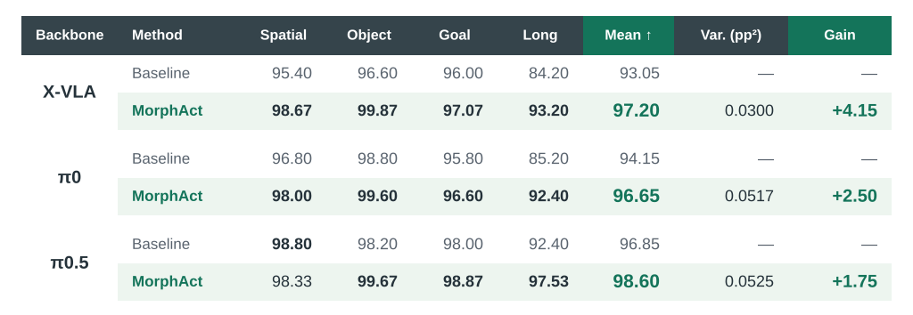
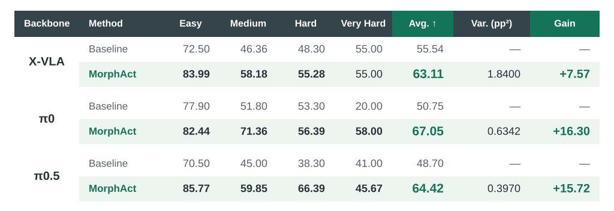

<h1 align="center"></h1>

<p align="center">
  <a href="https://ziyanliux.github.io/">Ziyan Liu</a><sup>*</sup> · <a href="https://jitingliu.com/">Jiting Liu</a><sup>*</sup> · Weihong Zhong<sup>*</sup> · Wenda Yu · Yeqiu Chen<br>
  Jason Li · Xiaojiang Peng · Shuyuan Hu · <a href="https://kaiwang960112.github.io/">Kai Wang</a><sup>†</sup> · <a href="https://www.bozhao.me/">Bo Zhao</a><sup>†</sup>
</p>

<p align="center"><sub>* Equal contribution. † Corresponding authors.</sub></p>

<p align="center">
  <a href="https://mint-sjtu.github.io/MorphAct.io/"></a>
  <a href="https://arxiv.org/abs/2610.20019"></a>
  <a href="https://huggingface.co/MINT-SJTU/MorphAct"></a>
</p>

<p align="center">
  <strong>English</strong> · <a href="README.zh-CN.md">简体中文</a>
</p>

Scaling robot learning brings diverse perceptual and control demands into one shared policy, across tasks and within a single interaction. Conventional policies keep their effective weights fixed across contexts. **MorphAct** learns a shared adaptation rule that generates **context-dependent parameter updates**, coupling vision–language and action adaptation through the representations used for control.


- **Operation-level evidence.** Different operations can favor competing parameter updates; our diagnostics show that reducing one task’s batch loss can increase loss on others.
- **Representation-coupled generation.** Observations and instructions guide vision–language updates; the adapted representations and robot state then guide action-side parameter generation.
- **Joint learning.** Both generators learn through the native action objective, without operation labels or test-time optimization. Their weights are shared across contexts.

*See results and robot demos on the [project page](https://mint-sjtu.github.io/MorphAct.io/).*

## 📊 Results (%)

### LIBERO

[](assets/results-libero-en.svg)

### Meta-World

[](assets/results-metaworld-en.svg)

## 🤗 Pretrained models

Download pretrained adapters for Meta-World and LIBERO from [MINT-SJTU/MorphAct](https://huggingface.co/MINT-SJTU/MorphAct).

Place each downloaded adapter under `ckpt/adapters/` using this directory name:

| Backbone | Meta-World | LIBERO |
|---|---|---|
| π0 | `pi0-metaworld` | `pi0-libero` |
| π0.5 | `pi05-metaworld` | `pi05-libero` |
| X-VLA | `xvla-metaworld` | `xvla-libero` |

Base-model paths and inference commands: [π0 / π0.5](openpi/README.md) · [X-VLA](xvla/README.md).

## 🚀 Quick start

On Linux with an NVIDIA GPU and `uv`, run these commands from the repository root with the π0.5 base model and `pi05-metaworld` checkpoint:

```bash
bash tools/install_openpi.sh
source artifacts/envs/openpi/bin/activate
bash tools/serve.sh pi05 metaworld
```

To evaluate it in Meta-World, follow the [simulator setup](docs/evaluation.md#simulator-setup), then run in a second terminal:

```bash
source artifacts/envs/metaworld-eval/bin/activate
bash tools/evaluate.sh pi05 metaworld
```

Use `pi0` for π0. X-VLA installation and inference are described in the [X-VLA guide](xvla/README.md). Evaluation outputs and score definitions are documented in the [evaluation guide](docs/evaluation.md#outputs).

## 🛠️ Training

To train MorphAct on your own data, see [π0 / π0.5 training](openpi/README.md#training) or [X-VLA training](xvla/README.md#training).

## Acknowledgements

The backbone integrations use OpenPI and X-VLA.

## Contact

- **Ziyan Liu:** [liuziyan@mail.ustc.edu.cn](mailto:liuziyan@mail.ustc.edu.cn)
- **Jiting Liu:** [liujiting616@gmail.com](mailto:liujiting616@gmail.com)

## License

Original MorphAct code is licensed under the [MIT License](LICENSE). Third-party components retain their respective licenses; see [NOTICE](NOTICE).

## Citation

If you find MorphAct useful in your research, please cite:

```bibtex
@misc{liu2026morphact,
  title         = {{MorphAct: Robot Policies Morphing with the Worlds They Act In}},
  author        = {Ziyan Liu and Jiting Liu and Weihong Zhong and Wenda Yu
                   and Yeqiu Chen and Jason Li and Xiaojiang Peng
                   and Shuyuan Hu and Kai Wang and Bo Zhao},
  year          = {2026},
  eprint        = {2610.20019},
  archivePrefix = {arXiv},
  primaryClass  = {cs.RO},
  url           = {https://arxiv.org/abs/2610.20019}
}
```
