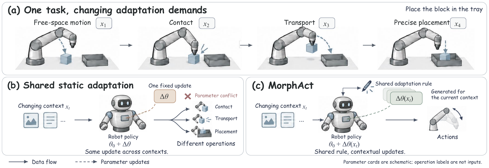

<h1 align="center">MorphAct</h1>

<p align="center">
  <strong>视觉–语言–动作模型的上下文参数化</strong>
</p>

<p align="center">
  <a href="https://mint-sjtu.github.io/MorphAct.io/">
    
  </a>
  &nbsp;
  <a href="#" title="论文即将发布">
    
  </a>
</p>

<p align="center">
  <a href="README.md">English</a> · <strong>简体中文</strong>
</p>

MorphAct 是一个**面向 VLA 的插件式动态参数生成框架**。它根据当前交互情境生成参数更新，让同一个策略在任务执行过程中动态调整感知与控制。

## 方法

即使是同一个操作任务，接近物体、建立接触、搬运和精确放置时的感知与控制需求也各不相同。这些情境会对策略提出不同的适配需求。

MorphAct 学习一套**共享的适配规则**，根据当前情境生成低秩参数更新，协同调整视觉语言模块与动作模块，使同一个策略能够适应交互过程中的变化。这一机制可以作为插件接入现有 VLA，沿用骨干原有的动作建模方式。



## 预训练模型

三种骨干的 Meta-World 预训练适配器可从 [MINT-SJTU/MorphAct-Metaworld](https://huggingface.co/MINT-SJTU/MorphAct-Metaworld) 下载。LIBERO 预训练权重 Coming soon。

将下载的适配器放入 `ckpt/adapters/`，目录名称如下：

| 骨干 | Meta-World | LIBERO |
|---|---|---|
| π0 | `pi0-metaworld` | Coming soon |
| π0.5 | `pi05-metaworld` | Coming soon |
| X-VLA | `xvla-metaworld` | Coming soon |

基座模型路径与推理命令：[π0 / π0.5](openpi/README.zh-CN.md) · [X-VLA](xvla/README.zh-CN.md)。

## 快速开始

使用带 NVIDIA GPU 的 Linux 环境，并安装 `uv`。以下命令均在仓库根目录执行，并准备好 π0.5 基座模型和 `pi05-metaworld` 检查点：

```bash
bash tools/install_openpi.sh
source artifacts/envs/openpi/bin/activate
bash tools/serve.sh pi05 metaworld
```

在 Meta-World 中评测时，先完成[仿真环境安装](docs/evaluation.zh-CN.md#仿真环境)，再打开第二个终端运行：

```bash
source artifacts/envs/metaworld-eval/bin/activate
bash tools/evaluate.sh pi05 metaworld
```

使用 π0 时将模型参数换为 `pi0`。X-VLA 的安装和推理见 [X-VLA 指南](xvla/README.zh-CN.md)。评测产物和得分定义见[评测指南](docs/evaluation.zh-CN.md#输出)。

## 实验结果（%）

### LIBERO

| 骨干 | 方法 | Spatial | Object | Goal | Long | Mean | 方差 (pp²) |
|---|---|---:|---:|---:|---:|---:|---:|
| X-VLA | Baseline | 95.40 | 96.60 | 96.00 | 84.20 | 93.05 | — |
| X-VLA | MorphAct | 98.67 | 99.87 | 97.07 | 93.20 | **97.20** | 0.0300 |
| π0 | Baseline | 96.80 | 98.80 | 95.80 | 85.20 | 94.15 | — |
| π0 | MorphAct | 98.00 | 99.60 | 96.60 | 92.40 | **96.65** | 0.0517 |
| π0.5 | Baseline | 98.80 | 98.20 | 98.00 | 92.40 | 96.85 | — |
| π0.5 | MorphAct | 98.33 | 99.67 | 98.87 | 97.53 | **98.60** | 0.0525 |

### Meta-World

| 骨干 | 方法 | Easy | Medium | Hard | Very Hard | Avg. | 方差 (pp²) |
|---|---|---:|---:|---:|---:|---:|---:|
| X-VLA | Baseline | 72.50 | 46.36 | 48.30 | 55.00 | 55.54 | — |
| X-VLA | MorphAct | 83.99 | 58.18 | 55.28 | 55.00 | **63.11** | 1.8400 |
| π0 | Baseline | 77.90 | 51.80 | 53.30 | 20.00 | 50.75 | — |
| π0 | MorphAct | 82.44 | 71.36 | 56.39 | 58.00 | **67.05** | 0.6342 |
| π0.5 | Baseline | 70.50 | 45.00 | 38.30 | 41.00 | 48.70 | — |
| π0.5 | MorphAct | 85.77 | 59.85 | 66.39 | 45.67 | **64.42** | 0.3970 |

## 训练

如需在自己的数据上训练 MorphAct，请参考 [π0 / π0.5 训练指南](openpi/README.zh-CN.md#训练)或 [X-VLA 训练指南](xvla/README.zh-CN.md#训练)。

## 致谢

骨干集成使用了 OpenPI 和 X-VLA。

## 许可证

MorphAct 自研代码采用 [MIT 许可证](LICENSE)。第三方组件沿用各自的许可证，详见 [NOTICE](NOTICE)。
