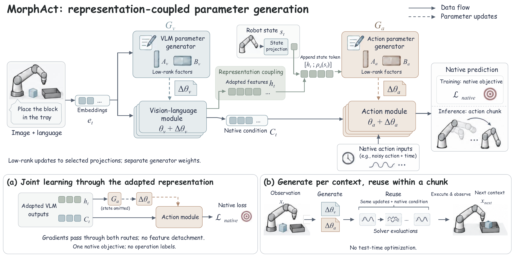
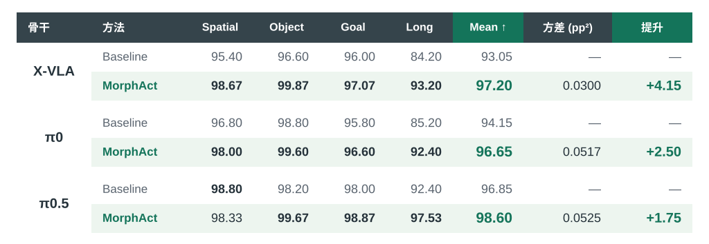
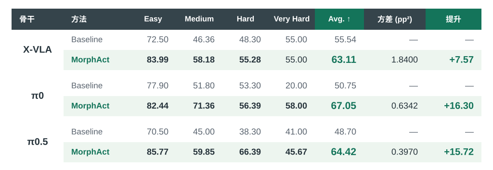

<h1 align="center"></h1>

<p align="center">
  <a href="https://ziyanliux.github.io/">Ziyan Liu</a><sup>*</sup> · <a href="https://jitingliu.com/">Jiting Liu</a><sup>*</sup> · Weihong Zhong<sup>*</sup> · Wenda Yu · Yeqiu Chen<br>
  Jason Li · Xiaojiang Peng · Shuyuan Hu · <a href="https://kaiwang960112.github.io/">Kai Wang</a><sup>†</sup> · <a href="https://www.bozhao.me/">Bo Zhao</a><sup>†</sup>
</p>

<p align="center"><sub>* 共同贡献。† 通讯作者。</sub></p>

<p align="center">
  <a href="https://mint-sjtu.github.io/MorphAct.io/"></a>
  
  <a href="https://huggingface.co/MINT-SJTU/MorphAct-Metaworld"></a>
</p>

<p align="center">
  <a href="README.md">English</a> · <strong>简体中文</strong>
</p>

将机器人学习扩展到多样的环境与交互，意味着同一个共享策略需要应对跨任务、甚至同一次交互中的不同感知与控制需求，而常规策略的有效权重始终固定。**MorphAct** 学习共享的适配规则，生成**上下文相关的参数更新**，通过用于控制的表征将视觉语言与动作适配连接起来。



- **操作级证据。** 不同操作可能需要相互竞争的参数更新；我们的诊断表明，降低一个任务批次损失的更新，可能增加其他任务的损失。
- **表征耦合的参数生成。** 观察与指令指导视觉语言侧的更新，适配后的表征与机器人状态进一步指导动作侧的参数生成。
- **联合学习。** 两个生成器通过原生动作目标共同学习，无需操作标签或测试时优化；生成器权重在不同上下文之间共享。

*前往[项目主页](https://mint-sjtu.github.io/MorphAct.io/)查看完整结果与机器人演示。*

## 📊 实验结果（%）

### LIBERO

[](assets/results-libero-zh.svg)

### Meta-World

[](assets/results-metaworld-zh.svg)

## 🤗 预训练模型

三种骨干的 Meta-World 预训练适配器可从 [MINT-SJTU/MorphAct-Metaworld](https://huggingface.co/MINT-SJTU/MorphAct-Metaworld) 下载。LIBERO 预训练权重 Coming soon。

将下载的适配器放入 `ckpt/adapters/`，目录名称如下：

| 骨干 | Meta-World | LIBERO |
|---|---|---|
| π0 | `pi0-metaworld` | Coming soon |
| π0.5 | `pi05-metaworld` | Coming soon |
| X-VLA | `xvla-metaworld` | Coming soon |

基座模型路径与推理命令：[π0 / π0.5](openpi/README.zh-CN.md) · [X-VLA](xvla/README.zh-CN.md)。

## 🚀 快速开始

使用带 NVIDIA GPU 的 Linux 环境，并安装 `uv`。以下命令均在仓库根目录执行，并准备好 π0.5 基座模型和 `pi05-metaworld` 检查点：

```bash
bash tools/install_openpi.sh
source artifacts/envs/openpi/bin/activate
bash tools/serve.sh pi05 metaworld
```

在 Meta-World 中评测时，先完成[仿真环境安装](docs/evaluation.zh-CN.md#仿真环境)，再打开第二个终端运行：

```bash
source artifacts/envs/metaworld-eval/bin/activate
bash tools/evaluate.sh pi05 metaworld
```

使用 π0 时将模型参数换为 `pi0`。X-VLA 的安装和推理见 [X-VLA 指南](xvla/README.zh-CN.md)。评测产物和得分定义见[评测指南](docs/evaluation.zh-CN.md#输出)。

## 🛠️ 训练

如需在自己的数据上训练 MorphAct，请参考 [π0 / π0.5 训练指南](openpi/README.zh-CN.md#训练)或 [X-VLA 训练指南](xvla/README.zh-CN.md#训练)。

## 致谢

骨干集成使用了 OpenPI 和 X-VLA。

## 联系我们

- **Ziyan Liu：**[liuziyan@mail.ustc.edu.cn](mailto:liuziyan@mail.ustc.edu.cn)
- **Jiting Liu：**[liujiting616@gmail.com](mailto:liujiting616@gmail.com)

## 许可证

MorphAct 自研代码采用 [MIT 许可证](LICENSE)。第三方组件沿用各自的许可证，详见 [NOTICE](NOTICE)。
